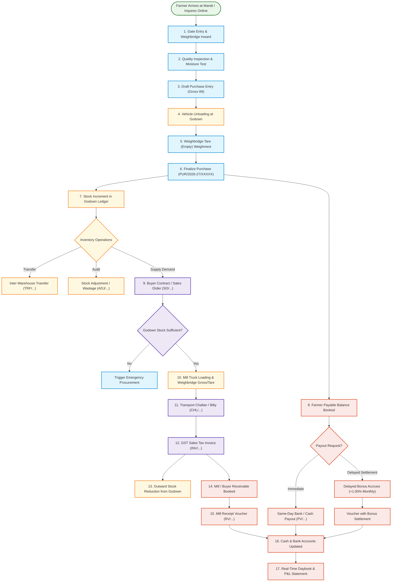
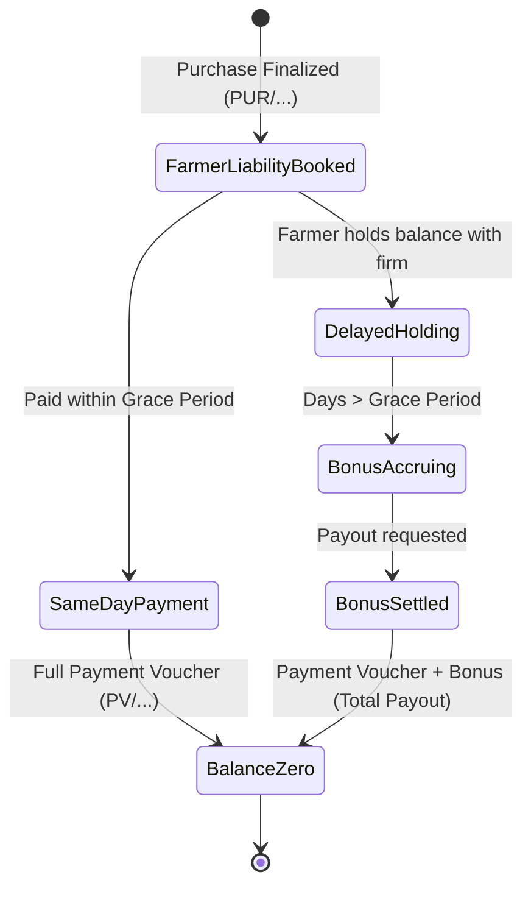
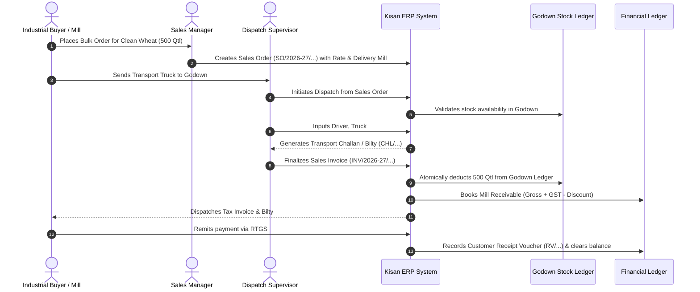

# Kisan Enterprises — Complete Agribusiness Operational Workflow & Architecture

**Kisan Enterprises ERP** is a production-grade, enterprise-ready grain trading and multi-warehouse management system tailored for the Indian agricultural procurement ecosystem (Agricultural Produce Market Committee / Krishi Upaj Mandi Samiti, Chandauli, UP).

This document details the complete end-to-end operational, physical, and financial workflow of the enterprise.

---

## 1. System Actors & Operational Roles

| Role | System Profile | Core Operational Responsibilities |
| :--- | :--- | :--- |
| **Farmer (Kisan)** | Public / Supplier | Registers online or at Mandi gate; checks daily mandi purchase rates; unloads crop; receives weight slips, instant payment vouchers, and monthly delayed settlement bonuses. |
| **Gate / Weighbridge Clerk** | Field Staff | Records vehicle gross weight, tare weight, moisture content, and refraction; issues computerized weighment slips. |
| **Quality Inspector** | Field Staff | Inspects moisture %, foreign matter, admixture, and grain shriveling; assigns quality grade (FAQ / Grade A / Rejection). |
| **Purchase Manager** | Procurement Lead | Enters or approves Purchase Bills (`PUR/...`); confirms crop variety and rate per quintal; commits inventory to destination godowns. |
| **Godown Keeper / Storekeeper** | Inventory Lead | Supervises unloading; verifies bags and physical stacks; executes inter-godown transfers (`TRF/...`) and periodic stock reconciliations. |
| **Sales Manager** | Commercial Lead | Manages buyer/mill agreements; creates Sales Orders (`SO/...`); locks sales rates and delivery terms. |
| **Dispatch Supervisor** | Logistics Lead | Inspects outbound trucks; generates Transport Delivery Challan / Bilty (`CHL/...`); verifies driver and weighment before final release. |
| **Accountant / Cashier** | Finance Lead | Processes farmer payments (`PV/...`); calculates delayed bonuses; records buyer payments (`RV/...`); logs daily expenses; balances the Daybook. |
| **General Admin** | Executive Management | Sets daily crop purchase rates; configures delayed settlement bonus %; manages user roles; views real-time P&L and audit logs. |

---

## 2. End-to-End Lifecycle Architecture



---

## 3. Operational Phases & Step-by-Step Breakdown

### Phase 1: Public Discovery & Farmer Onboarding
1. **Public Web Portal**: Farmers view live crop purchase rates (Wheat, Paddy, Mustard, Maize) on the public website with historical price trend graphs.
2. **Farmer Online Registration**: New farmers submit their Name, Mobile Number, Village, Tehsil, and Aadhaar card details online.
3. **Admin Verification**: Staff reviews incoming web registrations or registers walk-in farmers directly at the Mandi counter. An auto-generated unique Farmer ID (e.g., `FAR-00105`) is assigned.

---

### Phase 2: Mandi Gate Entry & Weighbridge Gross Weighment
1. **Vehicle Arrival**: Loaded tractor-trolley or truck drives onto the computerized digital weighbridge.
2. **Gross Weighment**: Weighbridge operator captures Gross Weight in kilograms (e.g., `8,450.000 kg`).
3. **Moisture & Refraction Sampling**: Quality inspector collects a composite grain sample.
   - Moisture meter reading is logged (e.g., `12.5%`).
   - If moisture exceeds base standard (e.g., `> 14%`), a standard weight or rate deduction is agreed upon.

---

### Phase 3: Vehicle Unloading, Tare Weighment & Purchase Finalization
1. **Unloading**: The grain is unloaded into designated bags or bulk heaps at the designated Godown (e.g., *Main Mandi Godown A*).
2. **Tare Weighment**: The empty vehicle returns to the weighbridge to record Tare Weight (e.g., `2,160.000 kg`).
3. **Net Weight Calculation** (`ProcurementService::calculate`):
   $$\text{Net Weight (kg)} = \text{Gross Weight (kg)} - \text{Tare Weight (kg)}$$
   $$\text{Net Quantity (Quintals)} = \frac{\text{Net Weight (kg)}}{100}$$
   $$\text{Base Amount} = \text{Net Quantity (Qtl)} \times \text{Rate per Quintal}$$
   $$\text{Net Payable} = \text{Base Amount} + \text{Additions (Labor/Bonus)} - \text{Deductions (Moisture/Bardana)}$$
4. **Finalization (`PUR/2026-27/XXXXX`)**:
   - Marking the purchase as **Finalized** atomically increases the stock ledger for that crop in the chosen warehouse.
   - Books the exact net payable balance to the farmer's account ledger.
   - An automated SMS / WhatsApp procurement receipt is dispatched to the farmer's registered mobile number.

---

### Phase 4: Multi-Godown Storage, Movements & Safeguards
1. **Godown Allocation**: Stock is immediately available in the godown ledger (`inventory_transactions`).
2. **Inter-Warehouse Transfers (`TRF/...`)**: When transferring grain between regional godowns (e.g., *Mandi Yard* to *Central Railway Siding Godown*):
   - Source warehouse stock is decremented (`direction: out`).
   - Destination warehouse stock is incremented (`direction: in`).
   - Transit status is tracked with driver and vehicle number.
3. **Stock Adjustments (`ADJ/...`)**: Physical stock verification reconciles differences due to moisture loss, handling, or bag spillage with auditable reasons.
4. **Low Stock Threshold Warning**: If godown stock falls below minimum safety levels (e.g., `< 10 Qtl`), visual alerts trigger on the executive dashboard.

---

### Phase 5: Buyer Agreements & Sales Orders
1. **Customer / Mill Master**: Industrial buyers (flour mills, rice mills, oil extractors, institutional traders) are onboarded with legal entity name, GSTIN (Regular, Composition, or Unregistered), and billing address.
2. **Sales Contract / Order (`SO/...`)**:
   - Sets contracted crop varieties, committed quintals, agreed rate per quintal, tax rate (GST 0% or 5%), and destination delivery/mill address.
   - Status flows through: `Draft` $\rightarrow$ `Approved` $\rightarrow$ `Dispatched` $\rightarrow$ `Completed`.

---

### Phase 6: Dispatch, Transport Bilty & GST Tax Invoicing
1. **Pre-Dispatch Stock Verification**: The system checks live warehouse stock. A sales dispatch cannot be finalized if available godown stock is insufficient.
2. **Loading & Transport Challan / Bilty (`CHL/...`)**:
   - Outbound truck driver name, mobile number, vehicle registration number, and mill delivery address are recorded.
   - Printable 2-copy Transport Delivery Bilty is generated for the driver.
3. **Finalize Sales Tax Invoice (`INV/2026-27/XXXXX`)**:
   - Atomically deducts grain from the specified godown ledger.
   - Calculates line items, GST breakdown (CGST + SGST or IGST), freight additions, and round-off to the nearest integer rupee.
   - Generates official GST tax invoice with bilingual Hindi/English headers.

---

### Phase 7: Financial Settlements, Delayed Bonus & Ledger Accounting



1. **Farmer Payment Vouchers (`PV/...`)**:
   - Cashiers can disburse funds via **Bank Transfer (NEFT/RTGS/IMPS)**, **Cash**, or **Cheque**.
   - Transaction reference / UTR number is recorded with double-submit protection.
2. **Delayed Settlement Incentive (Farmer Growth Fund)**:
   - Farmers who choose not to withdraw their money immediately earn an attractive delayed settlement bonus (e.g., **+1.00% per month**, calculated pro-rata per day).
   - When paying a delayed purchase, the system automatically computes:
     $$\text{Days Delayed} = \text{Current Date} - \text{Purchase Date}$$
     $$\text{Bonus Amount} = \text{Eligible Balance} \times \left(\frac{\text{Monthly Rate}}{30}\right) \times \text{Days Delayed}$$
     $$\text{Total Payout} = \text{Principal Amount} + \text{Bonus Amount}$$
   - Farmers receive a full voucher detailing principal settled plus bonus earned.
3. **Customer Receipts (`RV/...`)**:
   - Payments received from buyers/mills reduce their outstanding balance.
4. **Daily Daybook & Profit & Loss**:
   - Every rupee paid or received updates the real-time cash/bank accounts (`cash_accounts`).
   - The Daybook provides an immutable register of daily opening balance, inward receipts, outward expenses/payouts, and closing cash-in-hand.

---

### Phase 8: Audit Trails, Access Security & Maintenance
1. **Audit Logging (`AuditLogger`)**: Every critical event (purchase created, payment disbursed, rate edited, invoice reversed) records user ID, IP address, user agent, old values, and new values.
2. **Safe Reversals**: Finalized documents cannot be deleted directly. They must be formally reversed with a mandatory business reason, automatically restoring godown inventory and balance ledgers.
3. **Automated Database Backups**: Single-click encrypted MySQL dump with automated download and retention management.

---

## 4. Key Sequence: Procurement to Farmer Settlement

```mermaid
sequenceDiagram
    autonumber
    actor F as Farmer
    actor W as Weighbridge Clerk
    actor P as Purchase Manager
    actor C as Cashier
    participant ERP as Kisan ERP System
    participant DB as Godown Stock Ledger
    participant FIN as Financial Ledger

    F->>W: Drives loaded tractor to Mandi Gate
    W->>ERP: Inputs Gross Wt, Crop, Moisture & Grade
    ERP-->>W: Issues Inward Weigh Slip
    F->>W: Unloads grain at Godown; returns for Tare Weighment
    W->>ERP: Records Tare Weight & Net Wt computed
    P->>ERP: Verifies Rate/Qtl & finalizes Purchase
    ERP->>DB: Atomically increments Godown Stock (kg & Qtl)
    ERP->>FIN: Books Farmer Payable Balance (PUR/2026-27/...)
    ERP-->>F: Dispatches SMS / WhatsApp confirmation
    
    alt Immediate Settlement
        F->>C: Requests payment on same day
        C->>ERP: Creates Payment Voucher (Bank UTR / Cash)
        ERP->>FIN: Deducts Cash/Bank Account & zeros Farmer balance
        ERP-->>F: Issues Payment Receipt (PV/...)
    else Delayed Settlement (+1.00% Monthly Bonus)
        Note over F,ERP: Balance held for 20 days
        F->>C: Requests payout after 20 days
        C->>ERP: Opens Payment screen
        ERP->>ERP: Computes pro-rata bonus (+1.00% monthly)
        C->>ERP: Approves Total Payout (Principal + Bonus)
        ERP->>FIN: Disburses Principal + Bonus expense
        ERP-->>F: Issues Voucher with Bonus (PV/...)
    end
```

---

## 5. Key Sequence: Sales Order to Dispatch & Customer Invoicing



---

## 6. Document Numbering Conventions

All primary business records follow standard sequential prefixes bound to the active financial year (`2026-27`):

| Prefix | Document Type | Example |
| :--- | :--- | :--- |
| `PUR/` | Crop Purchase Receipt | `PUR/2026-27/00012` |
| `PV/` | Farmer Payment Voucher | `PV/2026-27/00008` |
| `SO/` | Customer Sales Order | `SO/2026-27/00004` |
| `INV/` | GST Sales Tax Invoice | `INV/2026-27/00006` |
| `CHL/` | Outward Transport Challan / Bilty | `CHL/2026-27/00006` |
| `RV/` | Customer Receipt Voucher | `RV/2026-27/00005` |
| `EXP/` | Operational Expense Voucher | `EXP/2026-27/00015` |
| `TRF/` | Inter-Warehouse Stock Transfer | `TRF/2026-27/00003` |
| `ADJ/` | Stock Audit Adjustment | `ADJ/2026-27/00002` |
| `FAR-` | Master Farmer Registration ID | `FAR-00105` |
| `CUST-` | Master Customer / Mill ID | `CUST-00042` |

---

## 7. Mathematical & Decimal Precision Guarantees

All quantities, weights, and currency amounts in Kisan Enterprises ERP are computed using PHP's Arbitrary Precision Math library (`bcmath`) to eliminate binary floating-point rounding discrepancies:

- **Weights (Kg & Qtl)**: Evaluated to 3 decimal places (`0.001 kg` / `1 gram` accuracy).
- **Currencies (₹ INR)**: Evaluated to 2 decimal places (`0.01` paisa accuracy) with standard integer rupee round-off on commercial invoices.
- **Percentages (GST, Moisture, Bonus)**: Evaluated to 2 decimal places.

---

## 8. Deployment & Operational Readiness

- **Platform**: Laravel 11.x, PHP 8.2+, MySQL 8.0+.
- **Localization**: Full bilingual Hindi & English UI support.
- **Responsive Layout**: Dual responsive desktop mode (Full 248px vs Compact 68px Icon Rail) and mobile touch-friendly layout (< 576px touch targets).
- **PWA & Offline Awareness**: Progressive Web App capabilities with offline transaction notice toasts and CSRF auto-refresh protection.
- **Verification Suite**: 130 automated PHPUnit integration tests covering all critical paths.

